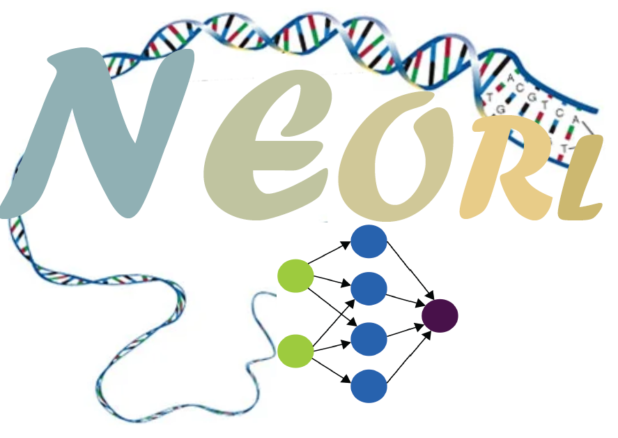
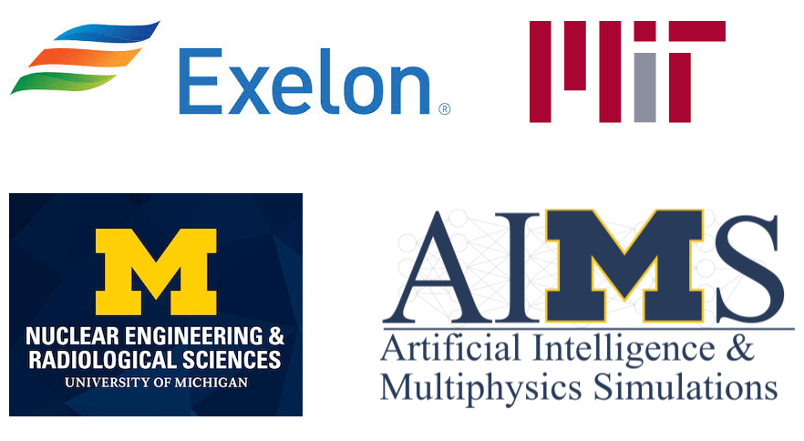

.. neorl documentation master file, created by Majdi I. Radaideh
   sphinx-quickstart on Thu Feb 25 19:34:47 2021.
   You can adapt this file completely to your liking, but it should at least
   contain the root `toctree` directive.

Welcome to NEORL Website!
=================================

**Primary contact to report bugs/issues**: Majdi I. Radaideh (radaideh@umich.edu)

------------------------------------------------------------------------------------------------------------------------------

   
NEORL (**N**\ euro\ **E**\ volution **O**\ ptimisation with **R**\ einforcement **L**\ earning) is a set of implementations of hybrid algorithms combining neural networks and evolutionary computation based on a wide range of machine learning and evolutionary intelligence architectures. NEORL aims to solve large-scale optimization problems relevant to operation & optimisation research, engineering, business, and other disciplines. 

Github repository: https://github.com/aims-umich/neorl/

NEORL paper: https://doi.org/10.1016/j.nucengdes.2023.112423

Copyright
--------------------------------------

   
This repository and its content are copyright of `Exelon Corporation <https://www.exeloncorp.com/>`_ © in collaboration with `MIT Nuclear Science and Engineering <https://web.mit.edu/nse/>`_  2021. NEORL is currently maintained by `Artificial Intelligence and Multiphysics Simulations (AIMS) Lab <https://www.aims-umich.com/>`_ at the `University of Michigan NERS <https://ners.engin.umich.edu/>`_ 2023. All rights reserved.

You can read the first successful application of NEORL for nuclear fuel optimisation in this `News Article <https://news.mit.edu/2020/want-cheaper-nuclear-energy-turn-design-process-game-1217>`_.

User Guide
--------------------------------------

.. toctree::
   :maxdepth: 2
   
   guide/guide
   modules/modules
   tune/tune
   examples/examples
   
.. toctree::
   :maxdepth: 1
   
   misc/changelog
   misc/projects
   misc/contrib
   misc/contribguide

Projects/Papers Using NEORL
--------------------------------------

1- Erdem, O. F., Price, D., Seurin, P., & Radaideh, M. I. (2026). MAEO: Scalable Multiobjective Animorphic Ensemble Optimization for large-scale optimization applications. Nuclear Engineering and Design, **458**, p. 115156 `[LINK1] <10.1016/j.nucengdes.2026.115156>`_.

2- Price, D., Radaideh, M. I. (2023). Animorphic ensemble optimization: a large-scale island model. Neural Computing and Applications, 35(4), 3221-3243 `[LINK2] <https://doi.org/10.1007/s00521-022-07878-y>`_.

3- Radaideh, M. I., Du, K., Seurin, P., Seyler, D., Gu, X., Wang, H., & Shirvan, K. (2023). NEORL: NeuroEvolution Optimization with Reinforcement Learning—Applications to carbon-free energy systems. Nuclear Engineering and Design, **412**, p. 112423 `[LINK3] <10.1016/j.nucengdes.2023.112423>`_.

4- Radaideh, M. I., Wolverton, I., Joseph, J., Tusar, J. J., Otgonbaatar, U., Roy, N., Forget, B., Shirvan, K. (2021). Physics-informed reinforcement learning optimization of nuclear assembly design. *Nuclear Engineering and Design*, **372**, p. 110966 `[LINK4] <https://doi.org/10.1016/j.nucengdes.2020.110966>`_.  

5- Radaideh, M. I., Shirvan, K. (2021). Rule-based reinforcement learning methodology to inform evolutionary algorithms for constrained optimization of engineering applications. *Knowledge-Based Systems*, **217**, p. 106836 `[LINK5] <https://doi.org/10.1016/j.knosys.2021.106836>`_.

6- Radaideh, M. I., Forget, B., Shirvan, K. (2021). Large-scale design optimisation of boiling water reactor bundles with neuroevolution. Annals of Nuclear Energy, 160, 108355 `[LINK6] <https://doi.org/10.1016/j.anucene.2021.108355>`_.

Citing the Project
--------------------------------------

To cite this repository in publications:

.. code-block:: bibtex

   @article{radaideh2023neorl,
   title={NEORL: NeuroEvolution Optimization with Reinforcement Learning—Applications to carbon-free energy systems},
   author={Radaideh, Majdi I and Du, Katelin and Seurin, Paul and Seyler, Devin and Gu, Xubo and Wang, Haijia and Shirvan, Koroush},
   journal={Nuclear Engineering and Design},
   volume={412},
   pages={112423},
   year={2023},
   publisher={Elsevier}
   }

Acknowledgments
--------------------------------------

NEORL was established in MIT back to 2020 with feedback, validation, and usage of different colleagues: Issac Wolverton (MIT Quest for Intelligence), Joshua Joseph (MIT Quest for Intelligence), Benoit Forget (MIT Nuclear Science and Engineering), Ugi Otgonbaatar (Exelon Corporation).

In January 2023, a `University of Michigan team <https://www.aims-umich.com/>`_ took over maintaining this repository after its founder, `Majdi Radadideh <https://ners.engin.umich.edu/people/radaideh-majdi/>`_, joined their faculty. Now NEORL is part of the `Artificial Intelligence and Multiphysics Simulations (AIMS) Lab <https://www.aims-umich.com/>`_ at the `University of Michigan NERS <https://ners.engin.umich.edu/>`_. 